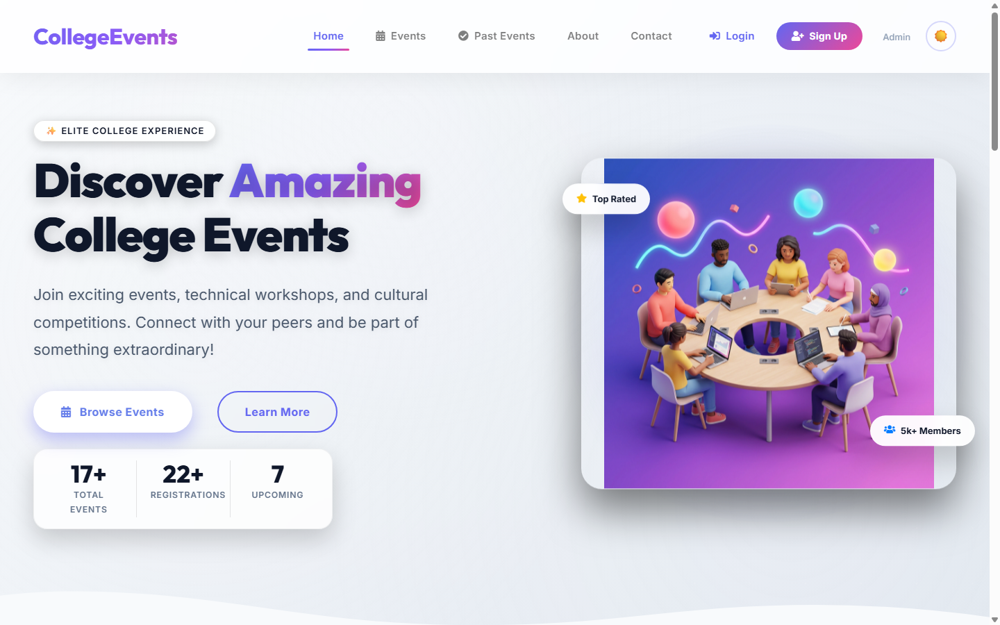
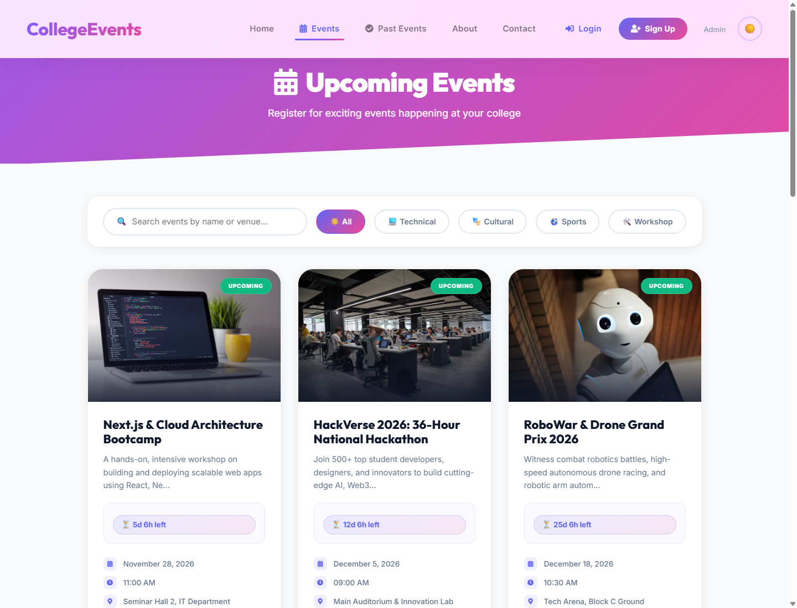
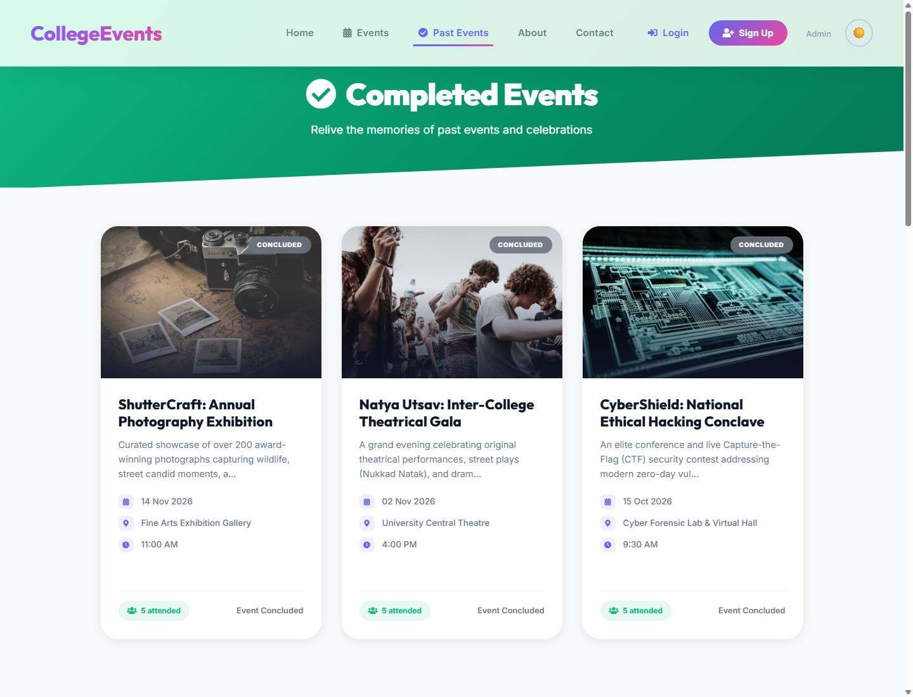
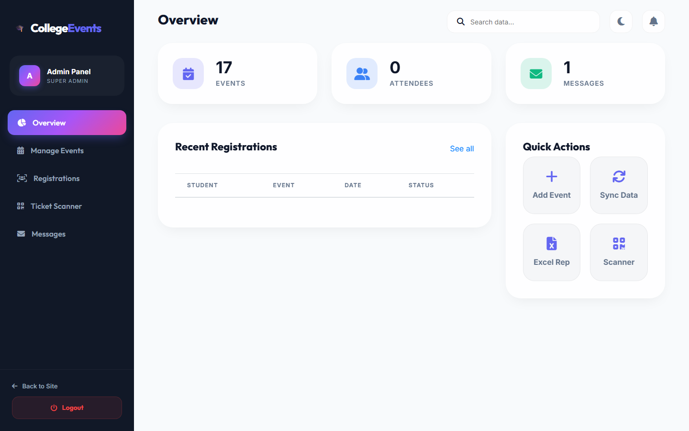

# 🎓 College Event Management System

Welcome to the **College Event Management System**, a comprehensive, feature-rich web application built with **Django**. Designed to streamline the organization, registration, and management of college events, this project combines a premium, modern UI with robust backend functionality.


---

## 🌟 Introduction

Managing college events—from technical symposiums and coding hackathons to cultural fests—can be chaotic. The **College Event Management System** resolves this by providing an end-to-end platform where:
- **Students** can easily browse upcoming events, sign up securely, download smart QR-coded tickets, and manage their profiles.
- **Admin & Event Organizers** get a powerful dashboard to create events, track registrations, scan tickets for entry, and analyze participation statistics.

---

## 🚀 Key Features

### 🎓 For Students & Users
- **Browse Events:** View an organized catalog of upcoming and successfully completed events.
- **User Authentication:** Create a personalized student profile, log in safely, and track registered events. 
- **Guest Registration:** Option to register for events without making an account.
- **QR Code Ticketing:** Every registration generates a unique **QR Code Ticket**, which can be downloaded in PDF or Excel formats.
- **Automated Email Confirmations:** Instantly receive booking confirmations via EmailJS integration.
- **Dynamic Dashboards:** View your upcoming events, past participations, and download tickets straight from your personalized profile.

### 🛡️ For Admins & Organizers
- **Event CRUD Operations:** Easily Create, Read, Update, and Delete college events. Add details like date, time, venue, description, and promotional images.
- **Registration Tracking:** View exactly who has registered, what course/branch they belong to, and the registration timestamps.
- **Ticket Verification (QR Scanning):** Dedicated workflows for scanning QR tickets and validating attendee entry seamlessly.
- **Data Export:** Need hard copies or offline spreadsheets? Export full registration lists to **Excel (.xlsx)** or **PDF**.
- **Statistics Dashboard:** Get real-time analytics on event capacities and overall platform engagement.
- **Contact Management:** Monitor and reply to queries submitted by students via the integrated 'Contact Us' form.

### 🎨 Premium UI/UX Design
- **Glassmorphism & Modern Styling:** Sleek, attractive interfaces that will wow users right from the homepage.
- **Interactive Micro-animations:** Smooth hover effects, elegant transitions, and dynamically animated components.
- **Responsive Layout:** Works flawlessly across desktops, tablets, and mobile devices natively.
- **Beautiful Iconography & Colors:** Premium gradient color combinations and well-structured typography.

---

## 📸 Screenshots

### 🏠 Home Section (Full-Screen Desktop Experience)

*Modern edge-to-edge landing page featuring dynamic live stats, glassmorphism elements, vibrant gradients, and smooth interactive animations.*

### 📅 Upcoming Events & Filter Catalog

*Browse and register for upcoming events with live countdown timers, instant search, and category filtering (Technical, Cultural, Sports, Workshop).*

### 🏆 Completed Events Archive

*Explore past successfully organized college events with attendee statistics, photo showcases, and event recaps.*

### 🛡️ Admin Dashboard & Control Center

*Admin dashboard equipped with easy navigation for complete control over events, registration tracking, and ticket generation.*

---

## 🛠️ Tech Stack

This project is built atop modern technologies ensuring speed, reliability, and excellent user experience:

- **Backend System:** Python, Django 5.1
- **Database:** SQLite (default for development; easily migrateable to PostgreSQL)
- **Frontend Core:** HTML5, CSS3 (Vanilla Premium Stylings), JavaScript (Vanilla)
- **Ticket Export & Generation:**
  - `openpyxl` for Excel data handling.
  - `reportlab` & integrated QR code libraries for PDF tickets.
- **Email Service Delivery:** EmailJS (No backend-heavy mail servers required!)

---

## 📋 Prerequisites

Before setting up the project locally, ensure you have:
- Python 3.8 or higher installed
- `pip` (Python package manager)
- Basic knowledge of terminal/command prompt 
- *A virtual environment (highly recommended)*

---

## ⚙️ Installation & Quick Start

Follow these steps to deploy the system on your local machine:

### 1. Clone the Repository
```bash
git clone https://github.com/Pratik-techh/College-Event-Management-System.git
cd College-Event-Management-System
```

### 2. Create and Activate Virtual Environment
```bash
python -m venv venv
```
- **Windows:** `venv\Scripts\activate`
- **Mac/Linux:** `source venv/bin/activate`

### 3. Install Dependencies
```bash
pip install -r requirements.txt
```

### 4. Setup Database
Navigate into the core django application and apply the initial database schemas:
```bash
cd college_events
python manage.py migrate
```

### 5. Create Admin Superuser
To access the admin functionalities later, create an admin profile:
```bash
python manage.py createsuperuser
```
*(Follow the prompts to enter username, email, and password)*

### 6. Collect Static Files (Optional but Recommended)
```bash
python manage.py collectstatic
```

### 7. Run Development Server
```bash
python manage.py runserver
```
Visit **[http://127.0.0.1:8000/](http://127.0.0.1:8000/)** in your web browser. 

---

## 📖 How to Use the System

### For Students
1. Visit the homepage and click on **Browse Events**.
2. To easily track registrations, click "Sign Up" to create an account, filling in details like your Branch and Year.
3. Once logged in, select any upcoming event and click **Register Now**.
4. Receive a confirmation and head to your **Dashboard** to view or download your **QR Code Ticket**.
5. Have queries? Drop a message using the Contact layout.

### For Admins
1. Visit **[http://127.0.0.1:8000/admin/](http://127.0.0.1:8000/admin/)** and login with the superuser credentials created earlier.
2. Under the *Events* application, you can **Add Event** (fill in description, date, and image URLs).
3. Track new users under *Student Profiles*.
4. Head to the **Registrations Tab** to export the entire list to Excel/PDF for verification at the gates.

---

## 🔧 Integrations

### Setting up EmailJS
By default, the platform sends confirmation emails instantly when a student successfully registers. To link it to your own email:
1. Create a free account at [EmailJS](https://www.emailjs.com/).
2. Create an Email Service and an Email Template.
3. Gather your `Service ID`, `Template ID`, and `Public Key`.
4. Replace the placeholders in `static/events/script.js`:
   ```javascript
   const SERVICE_ID = 'your_service_id';
   const TEMPLATE_ID = 'your_template_id';
   const PUBLIC_KEY = 'your_public_key';
   ```

---

## 📚 Advanced Documentation

For deeper dive explanations, please review our separate markdown guides:
- **[SETUP.md](SETUP.md)**: Additional detailed installation and teardown notes.
- **[HOW_TO_RUN.md](HOW_TO_RUN.md)**: Daily developer run scripts and debugging hints.
- **[QUICK_REFERENCE.md](QUICK_REFERENCE.md)**: Cheat-sheet for database models and general app architecture.

---

## 🤝 Contributing

Contributions are heavily welcomed and encouraged! If you're looking to add a new feature, fix a bug, or redesign a component:

1. Fork the repository.
2. Create a new feature branch (`git checkout -b feature/AmazingFeature`).
3. Commit your changes logically (`git commit -m 'Add some AmazingFeature'`).
4. Push to the remote branch (`git push origin feature/AmazingFeature`).
5. Open a Pull Request! We'll review your code as quickly as possible.

---

## 📝 License

This project is licensed under the MIT License - feel free to use and modify the code. See the [LICENSE](LICENSE) file for details.

## 👤 Author

**Pratik-techh**  
Follow me around on [GitHub](https://github.com/Pratik-techh)!

## 🙏 Acknowledgments

- The incredible [Django Documentation](https://docs.djangoproject.com/en/5.1/).
- Open-Source Modern UI/UX guidelines and Glassmorphism techniques.
- [EmailJS](https://www.emailjs.com/) for making frontend emailing painless.
- The Python and Web Developer community.

## 📧 Contact

Running into issues? Want to collaborate? Open an issue on this repository or directly reach out at: **pratikmandolikar12@gmail.com**

---
<div align="center">
  <b>⭐ If this repository helped you in any way, please drop a Star! ⭐</b>
</div>
